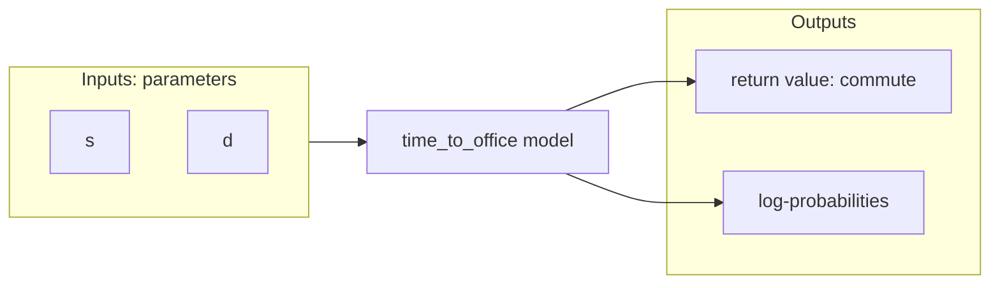
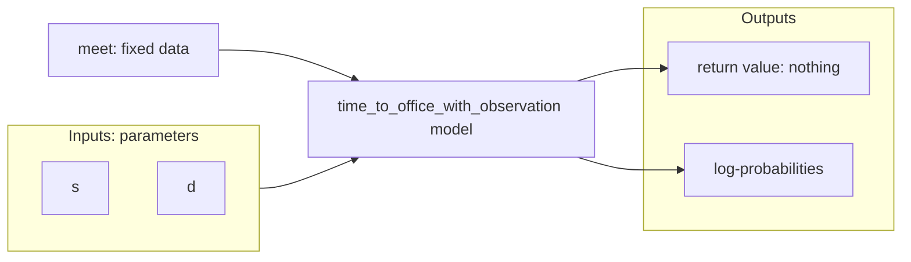
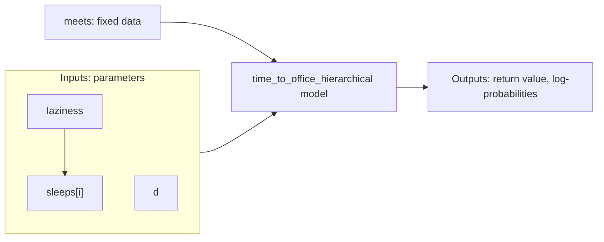

# [Probabilistic programming](@id beginner)

This page is intended to be a very gentle introduction to what probabilistic programming is all about.

If you are already familiar with other probabilistic programming languages, you may want to skip ahead to the [Syntax and semantics](@ref syntax) page.

We assume here that you have a basic understanding of probability distributions (e.g. the normal and Bernoulli distributions), and that you can read Julia code.

## Probabilistic functions

'Probabilistic programming' really just means that we can represent the idea of probability or nondeterminism in our programming language.
There are in fact many ways of doing this.
You don't even need to load a package!
You can just write a function that calls `rand()` directly:

```@example beginner
using Wren.Dists  # Provides the distribution objects.
using Random

function probabilistic_basic(rng=Random.default_rng())
    x = rand(rng, Normal(0, 1))
    return (; x)
end

probabilistic_basic()
```

Each time you call this function, it will return a different value for `x`:

```@example beginner
[probabilistic_basic() for _ in 1:5]
```

Wren.jl provides a `@wren` macro, which lets you write code that represents the same idea of having a random variable `x`:

```@example beginner
using Wren

@wren function probabilistic()
    x ~ Normal(0, 1)
    # and so on
end

model = probabilistic()
parameters(model)
```

The output type is slightly different from above, but conceptually you can see that it's still a container that has a value for `x`.

!!! note "Domain-specific language"

    Technically speaking, Wren is not a full programming language in and of itself: you might also hear the term *domain-specific language* (DSL) used for libraries like Wren.
    This means that it has some syntax of its own (e.g. the `~` operator) which is intended for a specialised use case (representing a probability distribution).
    However, it is *embedded* within a host language (Julia), which means that you can also use Julia code inside the Wren model.

## Forward simulation

A probabilistic model allows us to write down a relationship between a model's _variables_—its parameters, which we can't directly see—and the _observations_ which we do see.

The best way to understand this is to construct a simple (and sadly very realistic) example.
To get to work each morning, I have to take [the train](https://en.wikipedia.org/wiki/London_Underground).
Although the train is usually pretty reliable, [there are often delays](https://tfl.gov.uk/tube-dlr-overground/status/).
This introduces some randomness into my commute time.

For example, we might say that the time I spend on the train is 30 minutes, plus some delay `d` that's between 0 and 15 minutes.
Assuming that every possible value for the delay is equally likely, we could write this as:

```math
t = 30 + d, \quad d \sim \text{Uniform}(0, 15)
```

Here, `Uniform(0, 15)` represents the uniform distribution between the bounds 0 and 15, and the `~` symbol means 'is distributed as'.

Unfortunately for me, I might also sometimes oversleep!
Let's say that the chance of me oversleeping is 10%.
Then `s`, which is a number indicating whether or not I overslept, can be represented as a Bernoulli distribution.
Specifically, 0 means I woke up on time, and 1 means I overslept:

```math
s \sim \text{Bernoulli}(0.1)
```

If I oversleep, then I will leave the house ten minutes late.
Altogether, that means that my total commute time `commute` can be represented as:

```math
commute = 30 + d + 10s
```

Let's first write out the 'basic' version of this function in Julia code:

```@example beginner
function time_to_office_basic(rng=Random.default_rng())
    s = rand(rng, Bernoulli(0.1))   # Oversleep
    d = rand(rng, Uniform(0, 15))   # Train delay
    commute = 30 + d + (s * 10)     # Total commute time
    return commute
end
```

We can use this function to generate random samples of my commute time `commute` by calling it multiple times.
This is often referred to as *forward sampling* or *forward simulation*, because we're simply drawing new values for `s` and `d`, and then running the function forwards to get values of `commute`:

```@example beginner
[time_to_office_basic() for _ in 1:5]
```

Let's turn this into a Wren model.
For now, don't worry too much about the exact syntax; however, you should notice that the code we wrote is very similar to the mathematical expressions above.

```@example beginner
@wren function time_to_office()
    s ~ Bernoulli(0.1)            # Oversleeping
    d ~ Uniform(0, 15)            # Train delay
    commute = 30 + d + (s * 10)   # Total commute time
    return commute
end

model = time_to_office()
```

This model has two _parameters_: `s` and `d`.
Note that `commute` is not a parameter of the model, because it is fully deterministic: given values for `s` and `d`, we can compute the value of `commute` exactly.

If we wanted to perform forward sampling with this model, Wren provides a `return_value` function, which calculates the value of `commute` (since that is what the model returns):

```@example beginner
[return_value(model) for _ in 1:5]
```

## Tracking probabilities

At this point, you might well wonder what is the point of all this: surely our 'basic' functions that call `rand()` directly are already just as good as the 'fancy' Wren models!

However, it turns out that Wren models hide a lot of extra power that isn't immediately obvious.
Behold:

```@example beginner
result = simulate(model)
```

The [`simulate`](@ref) function returns a bundle of not only the model's return value, but also the corresponding values of the parameters `s` and `d`, as well as the probability of those values occurring.
(We always track the logarithm of the probability rather than the probability itself: this allows us to accurately represent very small probabilities.)

!!! note "Tracked quantities"

    There is an extra field on this struct, called `tracked_quantities`; feel free to ignore this for now.

We can see that all the information is consistent with the model that we wrote above.
In particular, the return value is clearly equal to `30 + d + 10s`.
Furthermore, the probability (in this case the 'log-prior'—we'll explain that later) is the sum of the individual log-densities, which we can calculate using `Wren.logdensityof`:

```@example beginner
# Get the values of `s` and `d`. Again, don't worry too much about the
# exact syntax here, except to convince yourself that we are indeed
# performing some sort of lookup to get the values of the named parameters.
result_s = parameters(result)[@vn(s)]
result_d = parameters(result)[@vn(d)]

# Calculate the associated log-density.
logdensityof(Bernoulli(0.1), result_s) + logdensityof(Uniform(0, 15), result_d)
```

You certainly _could_ have done this yourself by extending the 'basic' function to store the values of `s` and `d` and include the calls to `logdensityof`.
However, Wren does all this automatically for you, and you don't have to modify your model to do so.

Essentially, in writing the model, you have given Wren something akin to a description of the model.
Wren then uses that description to automatically generate the code which samples new values for the parameters, calculates the return value, and tracks the log-probability of those parameter values.

Before we go on, it's worth noting that the return value, as well as the log-probability, are considered to be _outputs_ of the model.
These are both functions of the parameters, which one may think of as the _inputs_ to the model.



!!! note "Using specific parameter values"

    So far, we have always generated fresh inputs for the model each time we ran the simulation—i.e., fresh values for `s` and `d`—by drawing from their distributions.
    (That is what `return_value` and `simulate` do if not given any other arguments.)

    However, it is often also very useful to be able to evaluate the model for a specific set of inputs.
    (We won't go into detail here, but this is often used in various inference algorithms, such as Markov chain Monte Carlo.)
    This is another reason why Wren is more powerful than the 'basic' function: it allows you to replace the calls to `rand(distribution)` with specific values that you are interested in.
    You could do this in the 'basic' version by supplying an optional argument, checking its value, and then calling `rand` only if it is not provided.
    But this gets quite cumbersome very quickly!

### Prior and likelihood

You might now be wondering why we might care about the probability of the parameters.
You might also wonder what is the 'log-likelihood' field in the `ModelResult` object above, which is currently zero.
It turns out that both of these are very much related, in that they are both used to calculate the *posterior distribution* which Bayesian statistics is all about.

Broadly speaking, the log-prior is the probability density associated with the parameters themselves.
In other words, how plausible do we think a value of `d=10` (or `d=5`, or whatever value we obtained from `simulate` above) would be without taking any of our observations into account?
That's why the log-densities of `s` and `d` were counted under the `logprior` field.

The log-likelihood, on the other hand, is the probability density associated with *outcomes* of the model.
Often we call these 'data', or 'observations'.
That's because in most modelling scenarios, the parameters themselves are not directly observable, but the outcomes of them are.
We can only use the data to 'reconstruct' or 'infer' the parameters, i.e., go backwards from data to parameters, effectively reversing the forward simulation we ran first.

In our model, we haven't yet defined any observations, which is why the log-likelihood is zero.

!!! details "Bayes' theorem (click to expand)"

    Fundamentally, the components of the probability above are related to Bayes' theorem:

    ```math
    p(\mathbf{\theta} | \mathcal{D}) = \frac{p(\mathcal{D} | \mathbf{\theta}) p(\mathbf{\theta})}{p(\mathcal{D})}
    ```

    Here, ``\mathbf{\theta}`` represents the parameters (`s` and `d` in our case), and ``\mathcal{D}`` is the set of observations (`meet` in our case).
    Taking the logarithm of both sides:

    ```math
    \underbrace{\log p(\mathbf{\theta} | \mathcal{D})}_{\text{log-posterior}}
        = \underbrace{\log p(\mathcal{D} | \mathbf{\theta})}_{\text{log-likelihood}}
        + \underbrace{\log p(\mathbf{\theta})}_{\text{log-prior}}
        - \underbrace{\log p(\mathcal{D})}_{\text{constant}}
    ```

    It turns out that the term ``\log p(\mathbf{\theta})`` corresponds precisely to `logprior`, and ``\log p(\mathcal{D} | \mathbf{\theta})`` to `loglikelihood`, both of which are given to us by Wren's `simulate` function.
    Furthermore, ``\log p(\mathcal{D})`` is a constant with respect to the parameters.
    This means that even when we're trying out different parameter values, we can just ignore it: as long as we don't change ``\mathcal{D}`` itself, this is just a constant.
    Thus, we can sum the log-prior and log-likelihood to get the *log-posterior*, up to a normalising constant.

    It's very common to call the sum of these two terms the 'log-joint', since that is technically what it represents (mathematically, it's ``\log p(\mathbf{\theta}, \mathcal{D})``).
    However, as far as Bayesian inference is concerned, the two are for all intents and purposes interchangeable.
    (Indeed, we won't go into the details in this page, but it turns out that in very many algorithms this constant will simply cancel out.)

## Inference

Now, we get to the heart of a probabilistic programming language: the ability to perform *inference*.
As mentioned above, in a model we have parameters (which we can't see, and contribute to the prior); and observations (which we can see, and contribute to the likelihood).
Inference is the process of using observations to learn something about the parameters.

### Adding observations to our model

To demonstrate this, let's flip the example above on its head.
Instead of me trying to simulate my own commute time, let's say that my manager at work has gotten tired of me turning up late and blaming the bad train service.
She doesn't take the train to work and thus can't directly verify whether the train was delayed; and she *certainly* can't observe whether or not I overslept.
To my manager, these are all hidden variables, and thus parameters of the Wren model she'll use to infer if I'm telling her the truth about my commute.

What my manager can observe, though, is the time that we first see each other in the office.
Now, because we might be doing different things when we get in, this time might not be _exactly_ the same time that I arrive at the office.

Let's say that on average, we meet 10 minutes after I arrive, with a standard deviation of 3 minutes:

```math
meet \sim \text{Normal}(commute + 10, 3)
```

!!! note "Choose distributions wisely!"

    Technically speaking, it is possible that `meet < commute`, which corresponds to a spooky situation where we meet at the office before I've actually arrived!
    The probability of this happening is around 0.04%, which is fairly small, but not zero.
    This could be improved by choosing a more realistic distribution (see [this cheatsheet (PDF)](https://learnbayes.se/cheatsheets/common_distributions.pdf) for a few distributions commonly used in Bayesian statistics).
    We won't do so here for simplicity, but this is a convenient time to point out that a model is only as good as the assumptions that go into it.

Because our meeting time is an observation, we mark it with the `@observe` macro.
We also need to specify a value for `meet`.
The easiest way to do this is to pass it as an argument to the function:

```@example beginner
@wren function time_to_office_with_observation(meet)
    s ~ Bernoulli(0.1)                      # Oversleeping
    d ~ Uniform(0, 15)                      # Train delay
    commute = 30 + d + (s * 10)             # Total commute time
    @observe meet ~ Normal(commute + 10, 3) # Time we meet in the office
    return nothing
end
```

How do we choose a value for `meet` to use?
Well, it's an observation—so that depends on what my manager has observed!
Suppose on a particular day, we first meet in the office at 9:35 am.
Flustered, I explain: 'I _swear_ I tried to leave the house at 8:45 am, but the trains were terrible today!'
From this, we can calculate that `meet = 50`.

```@example beginner
model = time_to_office_with_observation(50.0)
```

Note that although `meet` is now an argument to the model constructor, it's not a parameter of the model!
The parameters here are still only `s` and `d`.
`meet` takes a different role: it informs us which parameter configurations are more or less plausible.
We typically say that the model has now been _conditioned_ on the value `meet = 50` - the observation is like a constant that the model is now stuck with, and it'll try to find parameters that can accommodate it.



When we call `simulate` on this model, we now can see that the `loglikelihood` field is no longer zero.
That's because we've picked up a log-likelihood term from the `meet` observation:

```@example beginner
simulate(model)
```

What's important about this is that **collectively, the log-probabilities allow us to judge whether a set of parameter values are plausible or not**.
By trying out lots of different values for the parameters `s` and `d`, and seeing how the log-probabilities vary with them, we can start to form updated beliefs about what the real values of the parameters were.

### Using probabilities for inference

Concretely, we're going to use the following algorithm to get our updated beliefs:

 1. Perform lots of forward simulations.
    Recall that using `simulate` is equivalent to calling `rand(...)` on each of the parameters' distributions.
    This means that when we use `simulate`, we are drawing from the *prior* distribution of the model; that is, although the log-likelihood is nonzero, it does not affect the trajectory of the simulation.

 2. Having collected lots of *prior* simulations, we need to look at each of their log-likelihoods.
    If a simulation has a large likelihood, or equivalently a less negative log-likelihood, then the parameters in that simulation are to be considered more plausible (i.e., it is more likely that they could have given rise to the observations).

 3. We draw new samples from the prior simulations, but we *reweight* them according to their log-likelihood.
    Formally, if simulation ``i`` has log-likelihood ``\ell_i``, then the probability of re-selecting that simulation will be equal to ``\exp(\ell_i) / \sum_j \exp(\ell_j)``.
    This is also known as a ['softmax' operation](https://en.wikipedia.org/wiki/Softmax_function), and we'll use a function called `softmax` to do this for us in a numerically stable way.

If you want to read more, this algorithm is known as 'sampling–importance–resampling' (SIR), or sometimes loosely just 'importance sampling' (IS).
However, for the purposes of this page, you should just convince yourself that the description above is intuitively reasonable: we first draw samples according to the prior, and then 'correct' for the likelihood term which was ignored in the first step.

```@example beginner
samples = [simulate(model) for _ in 1:30_000]

using LogExpFunctions: softmax
loglikelihoods = [loglikelihood(spl) for spl in samples]
weights = softmax(loglikelihoods)

using StatsBase
posterior_samples = sample(samples, Weights(weights), 10_000)
nothing # hide
```

Let's look at one of these new samples:

```@example beginner
posterior_samples[1]
```

It is just a `ModelResult`, exactly like what `simulate` returns.
The difference, though, is that `posterior_samples` contains a distribution of samples that are from the posterior distribution.
To illustrate this, let's look at the percentage of samples where `s = 1` (i.e., I overslept):

```@example beginner
oversleeps = [parameters(spl)[@vn(s)] for spl in posterior_samples]
mean(oversleeps)
```

!!! note "Chain objects with Wren"

    It might appear a little bit cumbersome to continually map over vectors.
    However, the code above has been written with a minimal amount of dependencies in order to illustrate what's going on.
    When using Wren for inference, you will obtain a [`FlexiChains.VNChain`](https://juliabayes.org/FlexiChains.jl) object, which lets you perform operations such as calculating summary statistics much more easily.

It turns out that the *posterior probability* of me oversleeping—that is, my manager's updated belief about whether I overslept, based on what she saw of me—is smaller!
Conceptually, this means that other factors like the train delay are sufficient to explain my tardiness on that particular day.

!!! note "Choosing priors"

    When we started setting up our model, we wrote down the distributions `Bernoulli(0.1)` and `Uniform(0, 15)` for the parameters `s` and `d` simply based on our own knowledge of the situation.
    However, when we flipped the model around and looked at it from my manager's perspective, you might well wonder how she could have chosen those distributions without having perfect knowledge of the situation.

    It turns out that this is a general problem in Bayesian inference: we need to choose sensible 'prior distributions' for the parameters.
    We often don't know exactly what these will be, and can only make educated guesses.
    For example, for the train delay, my manager might have looked at historical trends of train delays to get a sense of what a reasonable range might be.
    And as for the oversleeping, it might just be a wild guess based on her knowledge of my character.

    Just like the likelihood term where we pointed out that the choice of distribution can make a model better or worse, so can the choice of prior distributions.
    We don't have the space to discuss this in detail here, but if you're interested do check out the resources in the [Further reading](@ref beginner-further-reading) section below.

## What's 'probabilistic' about it?

Inference, in general, is a very broad term, and can refer to any process of drawing conclusions from data.
However, in the context of probabilistic programming, the specific information that we obtain comes in the form of a *distribution*.

That is to say, we don't just get a single value for the parameters: we can't answer the question of 'did I oversleep or not?' with a binary yes/no answer.
Instead, we get from our algorithm a number of _samples_ for the variable `s`, each of which can either be 0 or 1.
This allows us to effectively express our confidence in the results ('what was the probability that I overslept?') in a way that a single value cannot.

For a more interesting example, we could also look at the distribution of `d`, the train delay.
This reflects my manager's updated belief about how late the train was on that day, given her observations:

```@example beginner
using CairoMakie: density, save

delays = [parameters(spl)[@vn(d)] for spl in posterior_samples]
figure = density(delays)
save("beginner__density_d.png", figure); # hide
```


Recall that we started our model off by thinking that the train delay was `Uniform(0, 15)`, i.e., all values inside that interval were equally likely.
This posterior distribution clearly shows that we have formed some beliefs about which values of `d` were more likely than others!

## Extending our model

Having seen a fairly simple example of a probabilistic model, this section will attempt to make it more realistic by adding some extra features.
You will likely see some of these elements in the models you encounter as you learn more about Bayesian statistics.

Try not to focus too much on the syntax of Wren here!
These models are just intended as illustrations of typical practices in Bayesian modelling, rather than a specific tutorial on how to use Wren.

In real life, it's very unlikely that my manager will have developed suspicions of me oversleeping simply based on one day of me being late.
It's more likely that she will have noticed a consistent pattern of me being late over a period of time.

We can represent this by having multiple observations of `meet` over a period of time.
The model is exactly the same, except that we now pass in a vector of observations and loop over them:

```@example beginner
@wren function time_to_office_expanded_1(meets)
    s ~ Bernoulli(0.1)                           # Oversleeping
    d ~ Uniform(0, 15)                           # Train delay
    commute = 30 + d + (s * 10)                  # Total commute time
    for meet in meets
        @observe meet ~ Normal(commute + 10, 3)  # Time we meet on each day
    end
    return nothing
end

meets = [50.0, 55.0, 60.0]    # Example observations.
model = time_to_office_expanded_1(meets)
```

You can rerun this model with the same sampling algorithm as before, and you should see that the posterior probabilities will have shifted.

However, there is a problem with this model: it only has a *single* parameter `s` for whether or not I overslept.
This means that the model assumes that I either overslept on all days, or on none of them, which is not realistic!
Thus, we might want to change the model to have a vector of parameters `sleeps` instead, one for each day.
(In theory, we should probably also make a vector of train delays, but for simplicity we'll ignore this for now.)

```@example beginner
@wren function time_to_office_expanded_2(sleeps, meets)
    d ~ Uniform(0, 15)                               # Train delay
    for i in eachindex(meets)
        sleeps[i] ~ Bernoulli(0.1)                   # Oversleeping on day i
        commute = 30 + d + (sleeps[i] * 10)
        @observe meets[i] ~ Normal(commute + 10, 3)  # Time we meet on day i
    end
    return nothing
end

sleeps = zeros(length(meets))   # An empty placeholder for the vector of parameters
model = time_to_office_expanded_2(sleeps, meets)
nothing # hide
```

We can then abstract this even further and make the probability of oversleeping on each day itself a distribution, instead of a fixed value of 0.1:

```@example beginner
@wren function time_to_office_hierarchical(sleeps, meets)
    laziness ~ Beta(1, 9)                            # Probability of oversleeping
    d ~ Uniform(0, 15)                               # Train delay
    for i in eachindex(meets)
        sleeps[i] ~ Bernoulli(laziness)              # Oversleeping on day i
        commute = 30 + d + (sleeps[i] * 10)
        @observe meets[i] ~ Normal(commute + 10, 3)  # Time we meet on day i
    end
    return nothing
end

model = time_to_office_hierarchical(sleeps, meets)
nothing # hide
```



Why would we want to introduce an extra parameter like `laziness`?

If we go back to `time_to_office_expanded_2`, where we defined a vector of `sleeps`, we can see here that all the `sleeps[i]` are completely independent.
Between each iteration of the for loop, the value of `sleeps[i]` is drawn anew from the Bernoulli distribution.

However, logically, all the `sleeps[i]` should be correlated: they all stem from an underlying tendency of me to oversleep, represented by `laziness`.
Our model needs to be able to use this correlation, or equivalently, 'remember' facts about me from one day to the next.
Making them collectively depend on a single parameter allows us to express this.

The `laziness` parameter also has a deeper meaning than just the individual `sleeps[i]`: it is a holistic representation of how prone I am to oversleeping, as opposed to just a question of whether I happened to oversleep on a particular day.

!!! warning "Don't use the algorithm above on this model"

    You might be tempted to run our simple sampling–importance–resampling algorithm on this model.
    Unfortunately, although it will certainly give you some results, the quality of those results will rapidly degrade as you add more days (and hence more parameters) to the model.
    In such a case, you'll need to use a more sophisticated inference algorithm to get good results.

Situations like these where you have a way to 'partition' your data into groups, each of which has its own parameters that then depend on other parameters, are often referred to as *hierarchical models*.

## [Further reading](@id beginner-further-reading)

For more information about probabilistic programming and Bayesian inference, you might want to check out the various resources listed on the [Learn Bayes website](https://learnbayes.se/learn/resources/).
